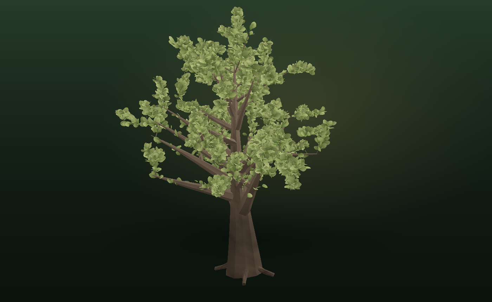

# Sapling — a procedural tree studio

**A browser-based tree generator in the spirit of SpeedTree, Tree It and Blender's Sapling
add-on.** Grow a tree from a seed, sculpt the branching in real time, watch it move in the
breeze, and take the mesh into Blender, Unity, Unreal or Godot as GLB or OBJ.



## What it does

- **Six species presets** — Oak, Maple, Birch, Willow, Pine and Blossom. Each is a full
  parameter set, not a static model; every tree is unique to its seed.
- **Real procedural growth** — a tapered, leaning, flaring trunk throws surface roots, then
  recursive limbs split down four levels of recursion with per-level angle, taper, droop,
  gravity and gnarl.
- **Two foliage models** — broadleaf cards (with slender willow blades) and stacked needle
  fans for conifers. Leaves are painted with per-card vertex colour gradients, budgeted so
  the silhouette always fills.
- **Live sculpting** — ~30 parameters with instant regeneration in a Web Worker, so dragging
  never blocks the viewport. Draft / Studio / Max preview budgets.
- **Studio presentation** — soft shadows, hemisphere fill, ACES tone mapping, ground haze,
  drifting pollen, turntable and a subtle wind shader.
- **Export that respects game engines** — binary glTF (`.glb`) with vertex colours and
  double-sided leaf material, or Wavefront OBJ + MTL zipped together with a README. Units are
  metres, origin at the trunk base, +Y up.
- **Seed sharing** — the URL hash carries the species and seed, so the share button copies a link
  that regrows the exact tree. Designs also export as JSON and can be loaded back.
- **Safe loading** — imported designs are sanitised against hard bounds, so a hand-edited file
  can never stall the generator.
- **Preset restore** — click the already-selected species in the field guide to undo sculpting
  and return to its untouched preset.

## Running it

```bash
npm install
npm run dev      # http://localhost:5173
npm run build    # static build in dist/
npm test
```

Requires a WebGL 2 browser for the live view. Nothing is uploaded — generation and export
happen entirely on the client.

### If the 3D preview does not start

Sapling probes for a WebGL 2 context before building the renderer. When that fails (hardware
acceleration off, a remote desktop session, a lost GPU context, or an older browser) the
studio switches to a **software still preview** rendered on the CPU: sculpting, seed sharing
and GLB/OBJ export keep working, and a banner offers **Retry 3D** plus a copyable diagnostics
report. Common fixes:

- enable hardware acceleration in the browser settings and restart the browser,
- close other tabs that are holding WebGL contexts,
- check `chrome://gpu` or `about:support` for a blocked/blacklisted driver,
- try a different browser if the GPU is simply unavailable (VMs, remote sessions).

Optional: regenerate the species thumbnails after changing a preset.

```bash
node tools/render-thumbs.mjs
```

## Controls

| Input | Action |
| --- | --- |
| Drag | Orbit |
| Scroll | Zoom |
| Right-drag | Pan |
| `R` | Grow a new seed |
| `T` | Turntable on/off |
| `Space` | Wind on/off |
| `E` | Export dialog |
| `Shift` + `R` | Random species and seed |
| `H` | Help |

## How the generator works

```
trunk      a polyline of 24–40 sections, tapered, leaning, with a smooth foot flare
roots      radial ridges that start high on the trunk and dive below the soil line
branches   each trunk node grows 1–4 limbs; every limb recursively splits
           with the branching angle, taper and droop applied per level
foliage    leaf cards are distributed from twig tips inward, with a weighted
           budget so outer twigs get leaves first
colour     bark is tinted per vertex by height and banding; leaves are baked
           as three-colour gradients in the vertex colours
```

The geometry is emitted as two `BufferGeometry` meshes (bark and foliage) built by a small
parallel-transport tube generator, which keeps limbs from twisting as they curve.

## Project layout

```
src/generator/   rng, params + species, tube/tube-frame geometry, tree growth, worker
src/render/      three.js stage: lighting, ground, wind shader, orbiting camera
src/ui/          schema-driven control panel, control primitives, share-link parsing
src/export/      GLB / OBJ+MTL / parameter exporters
src/main.js      app state, interactions, hotkeys, export flow
tools/           offline software rasterizer for previewing silhouettes in CI
test/            node:test suites for the generator, worker transfer, panel, exporters,
                  permalinks, markup contract and a full app boot against a stubbed
                  WebGL stage (including an axe accessibility pass)
public/thumbs    species thumbnails rendered from the generator itself
```

`tools/render-preview.mjs` and `tools/render-thumbs.mjs` are development helpers: they
rasterise the real mesh with a tiny CPU renderer so the tree silhouettes can be checked
without a GPU. They are not part of the app bundle.

## Notes

- Leaf cards are intentionally double-sided; enable two-sided shading (or translucency) in
  your renderer and they read correctly from any angle.
- The JSON export contains the full parameter tree plus statistics, so a seed and a preset
  are enough to rebuild an identical tree.
